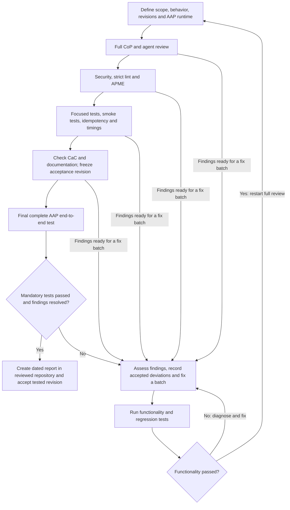

# Agent-generated code review

These are the review requirements for AI agent-generated Ansible automation in
the projects linked from AAP Advanced Features. They also cover supporting
Python, PowerShell, shell, Jinja, dependency definitions, execution environments
(EEs), and AAP configuration.

Start with [TLDR.md](TLDR.md) for a quick overview. This README is the full local
policy; the complete upstream CoP guide remains part of the review baseline.

This change documents requirements. It does not install tools, configure CI,
alter deployed systems, or certify that existing projects meet the requirements.
Repository reviews start separately, with an explicit project and test scope.

## 1. Review baseline and complete CoP coverage

Follow the **whole** [Red Hat Ansible CoP Good Practices guide](https://redhat-cop.github.io/automation-good-practices/),
including its explanations, qualifications, and examples. A short checklist or
an automated scan does not replace reading and applying the guide.

The initial reference is upstream commit
[`fb5fcd6`](https://github.com/redhat-cop/automation-good-practices/tree/fb5fcd6f03c544909dbad352a352b421c41d7203).
At the start of each review, check upstream changes and record the exact guide
revision used. Review every directive, including rules expressed as bullets
within sections. Record a source location, outcome, and evidence for each one.

All thirteen areas must be accounted for:

| Area | Upstream source |
|---|---|
| Automation structures | [structures](https://github.com/redhat-cop/automation-good-practices/blob/fb5fcd6f03c544909dbad352a352b421c41d7203/structures/README.adoc) |
| Naming conventions | [naming_conventions](https://github.com/redhat-cop/automation-good-practices/blob/fb5fcd6f03c544909dbad352a352b421c41d7203/naming_conventions/README.adoc) |
| Roles | [roles](https://github.com/redhat-cop/automation-good-practices/blob/fb5fcd6f03c544909dbad352a352b421c41d7203/roles/README.adoc) |
| Collections | [collections](https://github.com/redhat-cop/automation-good-practices/blob/fb5fcd6f03c544909dbad352a352b421c41d7203/collections/README.adoc) |
| Playbooks | [playbooks](https://github.com/redhat-cop/automation-good-practices/blob/fb5fcd6f03c544909dbad352a352b421c41d7203/playbooks/README.adoc) |
| Inventories and variables | [inventories](https://github.com/redhat-cop/automation-good-practices/blob/fb5fcd6f03c544909dbad352a352b421c41d7203/inventories/README.adoc) |
| Plugins | [plugins](https://github.com/redhat-cop/automation-good-practices/blob/fb5fcd6f03c544909dbad352a352b421c41d7203/plugins/README.adoc) |
| Coding style | [coding_style](https://github.com/redhat-cop/automation-good-practices/blob/fb5fcd6f03c544909dbad352a352b421c41d7203/coding_style/README.adoc) |
| AAP configuration as code | [aap_configuration](https://github.com/redhat-cop/automation-good-practices/blob/fb5fcd6f03c544909dbad352a352b421c41d7203/aap_configuration/README.adoc) |
| Git workflow and versioning | [git_workflow](https://github.com/redhat-cop/automation-good-practices/blob/fb5fcd6f03c544909dbad352a352b421c41d7203/git_workflow/README.adoc) |
| Testing | [testing](https://github.com/redhat-cop/automation-good-practices/blob/fb5fcd6f03c544909dbad352a352b421c41d7203/testing/README.adoc) |
| CI/CD and promotion | [cicd_and_promotion](https://github.com/redhat-cop/automation-good-practices/blob/fb5fcd6f03c544909dbad352a352b421c41d7203/cicd_and_promotion/README.adoc) |
| Security | [security](https://github.com/redhat-cop/automation-good-practices/blob/fb5fcd6f03c544909dbad352a352b421c41d7203/security/README.adoc) |

Use pass, fixed, justified not applicable, accepted deviation, or unresolved as
outcomes. Missing tooling or missing evidence means incomplete, not pass.
An entire area must not disappear because a tool cannot check it. Record
deviations under the proportionality rule below, including any material decision
requiring owner approval.

Explicit owner requirements take precedence over external recommendations.
Resolve conflicting or historical guidance against the actual supported AAP
runtime and document the resolution. For example, guidance specifically about
obsolete control-node platforms does not establish a compatibility requirement
for a current AAP EE. Keep short explanatory comments as required below.
The owner-selected repository name is retained without renaming it to match a
different naming convention in the guide.

### Proportionate improvements and accepted deviations

The goal is useful, reliable automation for its documented environment, with
effort proportionate to benefit. **A successful review does not require 100%
conformance or perfection.** Review every requirement, but do not spend huge
amounts of effort on a change with little practical benefit or introduce extra
complexity merely to satisfy a recommendation.

For each finding, weigh the benefit to functionality, security, maintainability,
readability, and speed against implementation effort, regression risk, added
complexity, and ongoing maintenance. The reviewing agent may accept a low-impact
deviation when correction is clearly disproportionate, documenting the reasoning
under this owner-authorized policy. A separate human readability check or
approval for every minor finding is not required. Material scope, architecture,
security, or access-control decisions still require the owner's authorization.

The dated review report must list each accepted deviation or known limitation:
the affected requirement and code, practical impact, benefit of fixing it,
estimated effort and regression/maintenance costs, reason for acceptance, and
any condition that would make revisiting it worthwhile. State uncertainty rather
than inventing precise estimates. Acceptance may be recorded as **accepted with
documented deviations**. An accepted deviation is a resolved disposition, not a
claim that the code conforms to the original recommendation.

Required functionality must still be demonstrated by successful tests, including
the final full AAP end-to-end test. Proportionality does not authorize exposing
secrets, bypassing security/access controls, or presenting missing or failed
mandatory test evidence as a successful review. Explicitly unsupported platforms
are outside the declared scope rather than defects requiring implementation.

## 2. Red Hat development guidance and security references

Use the documentation for the deployed AAP release. For the current AAP 2.7
baseline, the [Develop guide](https://docs.redhat.com/en/documentation/red_hat_ansible_automation_platform/2.7/pdfs/aap-develop-2-7-pdf.pdf)
is our product content-development reference. The locally supplied edition is
dated July 21, 2026; the following are its printed page numbers:

| Pages | Development reference |
|---|---|
| 39–50 | Development tools, create/test/deploy workflow, SCM, and AAP execution |
| 51–59 | Role and collection development, documentation, PAH publication, and EE consumption |
| 66–89 | Local execution and inspection with automation content navigator |
| 311–313 | Execution practices, dependency declaration, inventory, and CI/CD |
| 314 onward | Execution environment definitions and building |

Read the relevant procedures in full for the content under review. Use the
[Secure guide](https://docs.redhat.com/en/documentation/red_hat_ansible_automation_platform/2.7/pdfs/aap-secure-2-7-pdf.pdf)
and applicable Red Hat product documentation for security, supported
configuration, and deployment decisions. Record differences between the local
documentation edition, current vendor guidance, and the deployed runtime.

Review security-relevant configuration against the appropriate
[CIS Benchmark](https://www.cisecurity.org/cis-benchmarks). Select the target
product, benchmark version, profile, and applicable controls before assessing
it. Record control-specific findings and exceptions. A generic code scan cannot
establish host compliance. CIS recommends testing benchmark settings before
deployment; profile selection must account for functionality and support.
[CIS profile guidance](https://www.cisecurity.org/cis-benchmarks/cis-benchmarks-faq).

Useful additional references to adopt where relevant are
[OpenSCAP with SCAP Security Guide](https://www.open-scap.org/security-policies/scap-security-guide/)
for runtime configuration assessment and
[NIST SSDF](https://csrc.nist.gov/pubs/sp/800/218/final) for development and
software supply-chain practices. These are proposed supporting references;
specific profiles, tools, and enforcement settings need to be selected per
project. DISA STIG or other compliance frameworks apply when explicitly
required. Do not introduce conflicting hardening settings merely to collect
more framework names.

## 3. Current AAP runtime and no deprecated features

Build all automation on the **current AAP-provided ansible-core version** for
the selected, supported AAP execution environment. Determine the actual version
inside that EE; a local CLI version or an image name is insufficient evidence.
Record AAP version, EE image digest, ansible-core, Python, and collection versions
in the review evidence. Reassess this baseline when AAP or its EE is updated.

Use that baseline for syntax checks, module documentation, argument validation,
lint compatibility, APME scans, and execution tests. Additional developer tools
may run separately, but must not silently change the target runtime. Do not
upgrade ansible-core independently to the newest upstream release or downgrade
it to retain obsolete code.

Do not use deprecated modules, parameters, syntax, configuration, or features.
Keep deprecation warnings enabled and investigate every reported deprecation.
Use supported replacements compatible with the AAP baseline and rerun the
review procedure. If a third-party dependency causes a warning, resolve its
version or replacement; an unresolved warning blocks acceptance. Hiding warnings
does not fix a deprecation.
[Ansible deprecation-warning setting](https://docs.ansible.com/projects/ansible/latest/reference_appendices/config.html#deprecation-warnings).

## 4. Readability, simplicity, and comments

Readability is a primary acceptance criterion. Prefer simple, explicit code to
dense expressions or the smallest possible line count. Use descriptive task,
role, handler, and variable names; clear data types; straightforward conditions;
and small files with a coherent purpose. Follow the guide's naming, formatting,
variable, and interface rules throughout supporting code as well.

**Assess readability and simplicity through agent review; human verification is
not required.** Additional independent agents may review the same revision and
confirm or challenge the assessment. Give them the relevant code, declared
environment, and review criteria. Record the agents' review scopes, concrete
findings, and resolution of disagreements. Do not describe agent consensus as
human verification or as functional-test evidence.

Keep playbooks easy to follow and roles focused. Remove duplication where it
improves clarity. Avoid unnecessary wrappers, frameworks, configuration switches,
fallback chains, nested logic, and speculative future features. Each check,
abstraction, and recovery path must serve an identifiable requirement.

Comment for clarity: briefly explain the **reason, goal, and chosen solution**
for significant logic and non-obvious decisions. Keep comments short and current.
Use task names to explain routine actions. Explain necessary direct API calls,
external scripts, non-idempotent operations, and unusual safeguards next to the
relevant code. Include the reason a simpler native approach is insufficient.

## 5. Native Ansible and collection selection

Use native Ansible capabilities and suitable modules or roles wherever possible
instead of `ansible.builtin.uri`, shell commands, or external scripts. Use FQCNs.
Verify real module interfaces and return values for the exact installed version.

Use **certified collections wherever possible**, including checking suitability,
support status, AAP/core compatibility, required dependencies, and availability
through private automation hub. If a certified option cannot meet the need,
explain the gap before choosing validated content, maintained community content,
or custom code. Collection certification does not replace functional testing.

MCP calls are acceptable. Agents should prefer available MCP tools for platform
operations. If automation itself needs MCP, declare and reproduce its runtime,
credentials, permissions, and failure handling. A necessary direct API call or
script must have a documented reason and remain small, testable, and protected.

## 6. Idempotency, failure handling, and recovery

Avoid non-idempotent modules and code whenever an idempotent solution exists.
Test the same desired state twice and verify that the second application causes
no unintended change. Check the actual state as well as reported change counts.
Setting `changed_when: false` alone does not make an operation idempotent.

Use handlers for appropriate change-triggered work. Support check mode where
possible and document genuine limitations. Read-only checks must remain
read-only, including those deliberately executed during check mode.

Review partial completion, retries, timeouts, asynchronous completion, recovery,
and temporary-resource cleanup. Failure messages must be useful and sanitized.
Do not hide errors through blanket `ignore_errors`, unconditional success, or
rescue blocks that lose the original failure. Await and inspect external jobs.

Where a one-time or inherently changing operation is necessary, explain why,
guard its execution, report changes honestly, and test its repeat/recovery
behavior. Preserve required behavior and unrelated resources during cleanup.

## 7. Credentials and sensitive configuration outside code

Keep all sensitive values outside reusable code: tokens, usernames, passwords,
keys, hostnames, IP addresses, private endpoints, and environment-specific
security configuration. This covers templates, inventories, examples, tests,
documentation, exports, logs, generated files, and Git history.

Use AAP credentials, an approved external secret manager, or the project's
separate private secrets repository. Sensitive files committed to that secrets
repository must be Ansible Vault-encrypted. A private repository alone does not
protect plaintext values. Keep Vault passwords and decryption keys outside Git.
Public code contains variable references and generic placeholders only.

Protect task output, diffs, temporary files, artifacts, API responses, command
arguments, and cleanup paths. Keep diagnostic logging protected by default.
Retain TLS verification, least privilege, resource ownership checks, and explicit
target limits. Review secret rotation, revocation, RBAC, source/dependency
provenance, vulnerability findings, and image/SBOM evidence under the full CoP
security requirements. Never change access controls to make a test pass.

## 8. Private automation hub and custom collections

Use **private automation hub (PAH)** as the approved Ansible content store.
Declare exact collection versions in requirements and resolve them through PAH.
Prepare the required content there before project synchronization or EE builds.
Keep hub endpoints and access values in external protected configuration.

Do not vendor downloaded or installed collections, collection archives, or
`ansible_collections/` trees into playbook project repositories. Requirement
manifests and EE build definitions belong in Git; installed content and release
artifacts belong in the content store.

Custom collection **source may live in its own development repository**, as
confirmed by the owner. Explain the missing capability, why existing certified
or other maintained content is insufficient, the collection's interface,
ownership, tests, supported runtime, dependencies, and release process.
Publish versioned releases to PAH and consume them from PAH. Avoid copying their
implementation into consuming projects or downloading it directly from Git at
job runtime.

## 9. AAP execution and execution environments

Verify actual execution through normal AAP job templates and workflows. Review
inventory selection, limits, surveys, credentials, extra-variable precedence,
SCM revision, workflow dependencies, RBAC, timeouts, and concurrent execution.
The automation must run unattended without workstation paths, interactive
prompts, or files borrowed from another AAP project checkout.

Use AAP-provided EEs wherever they meet the requirements. Use the same EE
baseline during development verification and AAP execution. Record immutable
image/dependency references for acceptance and promotion.

When a custom EE is necessary, explain the need and provide:

- A version-controlled `execution-environment.yml` using the applicable supported
  Ansible Builder schema, based on an AAP-provided image and its core version.
- Exact collection requirements served by PAH, plus any Python requirements,
  system package requirements, and justified additional build steps.
- Reproducible build instructions, for example `ansible-builder build -f
  execution-environment.yml -t <image-reference>`, with tool versions and
  externally supplied registry/hub credentials and CA trust.
- Instructions for scanning, inspecting the resulting runtime, publishing the
  image to PAH's registry, registering it in AAP through CaC, and selecting it
  on the relevant templates. Record its digest and a rebuild/upgrade procedure.

Do not install dependencies interactively during ordinary job execution to
compensate for an incomplete EE definition.

## 10. Every project must be CaCable

Every created Ansible code project must be reproducible through configuration
as code (CaC). This requirement does **not** prescribe moving project source
into a central CaC repository or changing the existing repository layout.

Represent all required AAP objects and relationships reproducibly: projects,
SCM revisions, inventories and sources, credential types and attachments, EEs,
job templates, surveys, workflow nodes and links, relevant RBAC, and any required
schedules or settings. Keep their sensitive values in the protected stores
described above. Use suitable native configuration collections.

Document external/bootstrap prerequisites, ownership boundaries, import order,
and the entry point for restoration. Verify reconstruction and a repeated apply
on an authorized test platform. An export or a collection of API screenshots
alone does not prove that a project can be restored and run. Configuration
import must not implicitly launch runtime automation or enable unrequested
schedules. Keep temporary troubleshooting changes aligned with the CaC source.

## 11. Speed and proportionate verification

Speed is an explicit review criterion. Use actual AAP job/task timings to find
slow stages and compare equivalent before/after runs. Examine repeated fact
gathering, API queries, hashing, transfers, package loops, fixed sleeps, polling,
and unnecessary serial execution. Use native batching and safe parallelism when
they improve measured behavior without races or resource contention.

Keep development feedback fast by running inexpensive checks first and focused
tests during diagnosis. Remove redundant verification when another check already
proves the same property at the same trust boundary. Preserve required safety,
integrity, and completion checks. The final full end-to-end test is mandatory,
even when it is slow.

## 12. Strict linting and APME

Run strict Ansible linting across all Ansible content, including roles, task
files, handlers, examples, and tests. The default acceptance command is:

```sh
ansible-lint --profile production --strict
```

Use a reproducible tooling environment compatible with the target AAP core and
real collection dependencies. Review discovery/exclusion settings so files are
not silently missed. Resolve findings by fixes or documented accepted deviations;
keep exclusions narrow and explain every exception under the proportionality
rule. Do not generate a blanket ignore list or disable rules merely to obtain a
successful exit. Run appropriate checks for supporting languages too.
[Ansible lint usage](https://docs.ansible.com/projects/lint/usage/).

Use **APME (Ansible Policy & Modernization Engine)** in addition to linting.
Its upstream [architecture](https://github.com/ansible/apme/blob/9c4372f79a8b537865040cea17cf9db7659614ad/docs/architecture/06-validator-fanout.md)
describes these validator backends:

| Backend | Review contribution |
|---|---|
| Native | Static structure, risk, and modernization checks |
| OPA / Rego | Policy evaluation |
| Ansible | Core-version and module-interface compatibility checks |
| Gitleaks | Secret detection |
| Collection Health | Findings in collection dependencies |
| Dependency Audit | Known Python dependency vulnerabilities |

Record APME version, target core, policy/rule revisions, enabled validators,
health, completion status, and findings. Some validators are optional and
unconfigured validators are skipped; require evidence that each required backend
actually completed. Missing or failed coverage cannot count as a clean result.
Keep scans and dependency resolution within approved source and data boundaries.

APME supplements both `ansible-lint` and runtime tests. It does not establish
functional correctness or CIS compliance. Custom policy mappings need explicit
implementation and verification. The initial upstream assessment used commit
[`9c4372f`](https://github.com/ansible/apme/tree/9c4372f79a8b537865040cea17cf9db7659614ad).
Backend deployment and project-specific policy selection remain setup work;
this repository does not yet provide an installed review service or CI pipeline.
Use existing tools and obtain approval before installing missing dependencies.

## 13. Smoke tests and final end-to-end acceptance

Create smoke tests after provisioning. They must quickly verify the essential
service or integration behavior, required connectivity, and readiness for the
next stage. A successful provisioning task or a running process alone is
insufficient. Keep smoke tests focused, repeatable, and safe.

Use meaningful unit, role, integration, failure/recovery, and idempotency tests
as required by the full guide and the project's behavior. Tests should exercise
outcomes and relevant failure cases. Run applicable supported-platform scenarios
and document their actual coverage.

**The last acceptance test for functional code or runtime configuration is
always a complete end-to-end test through AAP.** Define its starting state,
complete workflow, supported scenarios, expected outcomes, smoke checks, and
preservation checks before launching it. Verify the final user-visible result,
actual job completion, and absence of unintended effects.

Collect findings from the review, assess proportionality, and fix the findings
selected for correction in a coherent batch. Record accepted deviations and
known limitations with their rationale. **Multiple
findings may be corrected in one run; there is no requirement to restart the
whole review after each individual finding or edit.** Track each finding and
continue gathering findings where useful, stopping unsafe execution when needed.

After applying the batch, run functionality tests covering the corrected behavior
and relevant regressions. If those tests fail, diagnose and fix the failures and
repeat the functionality tests. Once functionality passes, **restart the entire
code review procedure from the beginning** on the corrected revision, including
all checks and the final complete AAP end-to-end test.

Use this same fix-batch, functionality-test, and full-review cycle when the final
end-to-end test fails or findings require changes to code, dependencies, EEs,
runtime configuration, or tests/acceptance criteria. A successful rerun of only
the failed stage verifies the repair but cannot close the review; the restarted
review must still finish with the complete end-to-end test.

Acceptance applies to the exact tested revisions and dependency/EE baseline.
Recording evidence afterward must not change that tested artifact. If required
access or an authorized test environment is unavailable, report the review as
incomplete. This policy does not authorize deleting existing environments,
running destructive workflows, or changing unrelated deployed systems.

## 14. Review procedure and evidence



For every finding, record its file/location, practical consequence, rule/source,
proposed correction, priority, verification, and final disposition, including
cost/benefit reasoning for accepted deviations. Resolve
functional and security failures before cosmetic improvements. Keep changes
focused and preserve required functionality. Several findings may be fixed
together before functionality testing and the next full review pass.

The review record must identify the exact source/CaC/secrets revisions, runtime
versions, guide and policy versions, per-directive coverage, approved exceptions,
commands/job references, results, deprecations, timings, and remaining gaps.
Store sensitive evidence outside public code repositories and publish sanitized
summaries only. Account for each required check, any accepted deviation, and its
decision basis; unresolved findings or missing mandatory test evidence prevent
acceptance. Existing unrelated work must remain untouched.

### Successful review report in the reviewed repository

At the end of each successful review, create
**`Code_Review_YYYY-MM-DD.md` in the root of the repository that was reviewed**,
using the review completion date. For example, a review of the disconnected
Windows project produces the report in that project's own repository. A report
in this policy repository does not replace the reviewed project's report.

Create the completed report after findings are fixed or accepted as documented
deviations, functionality tests pass, and the full review and final AAP
end-to-end test succeed. Corrected code must have completed the restarted review
cycle described above. Commit it
with the reviewed project's documentation and link it from that project's
README. Identify the exact functional revision that passed; a later commit
containing only the report must not obscure which executable content was tested.

The report must include:

- Review scope, completion date, reviewer, policy/guide revisions, and the exact
  source and runtime/dependency baseline reviewed. Identify agent review scopes
  and any independent agent assessments of readability and simplicity.
- The documented supported environment, explicit unsupported platforms, and
  evidence that the documentation matches the implementation. A KVM-only
  project, for example, must say so without implying VMware support.
- Findings, their consequences, fixes and implementation commits, fix batches,
  and verification results. Record the final disposition of every finding.
- CoP and other required coverage, tool/validator completion, functionality and
  regression tests, smoke/idempotency checks, and the final complete AAP
  end-to-end result, with sanitized evidence references and relevant timings.
  Include an explicit **functionality confirmation: PASS**, identifying what was
  tested, when, on which source/runtime revision and supported environment, and
  the expected versus observed result. Job launch alone is not confirmation.
- Any **contradictions between review approaches or guidance**. Identify the
  conflicting sources and requirements, the affected context, the chosen
  approach, the alternatives, and the reason for the choice. Explain how the
  decision preserves functionality and meets the supported AAP baseline,
  including verification and any required exception approval. If no conflicts
  were identified, say so explicitly.
- Accepted deviations, approved exceptions, and known limitations. Include the
  benefit, effort, risk, and reason for leaving each accepted incompatibility or
  guideline deviation in place, plus any condition for revisiting it.
- The final acceptance conclusion, either accepted or accepted with documented
  deviations. Missing or failed mandatory functionality/end-to-end test evidence
  and unresolved findings prevent a successful review.

Keep the report sanitized under the sensitive-configuration rules above. Put
raw sensitive evidence in protected external storage and reference only safe
summaries from the committed report. Preserve previous completed review reports.

## 15. Documentation and process overview

Maintain a current README and `design_decisions_history.md` for every project.
Explain purpose, prerequisites, dependencies, inputs/outputs, AAP/CaC setup,
execution, tests, expected results, troubleshooting, recovery, and limitations.
Check documentation against the codebase for accuracy and sufficient detail to
set up, run, test, and recover the project in its supported environment. State
the environment it was built for, supported hypervisor/platform and versions,
AAP/EE baseline, prerequisites, assumptions, and explicit exclusions. For a
KVM-only implementation, document KVM support and that VMware is unsupported;
the review does not require adding another hypervisor. Treat unsupported and
untested claims distinctly. Assess adequacy and usefulness, not document length.
Record reasons and implementation commit IDs in the decision history; keep
patches and secrets out of it. Update documentation with implementation changes.

Provide a separate **TLDR document** for a quick overview, linked from the README.
It must stay consistent with the detailed documentation and preserve essential
prerequisites and cautions. Role and collection interfaces need their own
appropriate documentation.

When documentation or workflows are complex, provide a visual process overview
on **GitHub Pages (`github.io`)**, following the approach used by the disconnected
Windows demo. Show stages, dependencies, inputs, success conditions, and recovery
entry points. Keep diagrams sourced and maintained with the implementation and
link between the README, TLDR, and process overview. Public documentation must
use generic placeholders and sanitized results.

## Repository layout

- `README.md`: the full review requirements and authoritative local procedure.
- `TLDR.md`: the quick overview.
- `design_decisions_history.md`: decisions, reasons, and implementation commits.

There is no executable automation in this policy repository yet. Validate
documentation changes for consistency, links, formatting, and sensitive data.
Functional end-to-end acceptance applies when reviewing executable project
content; documentation validation alone does not qualify any project as reviewed.
